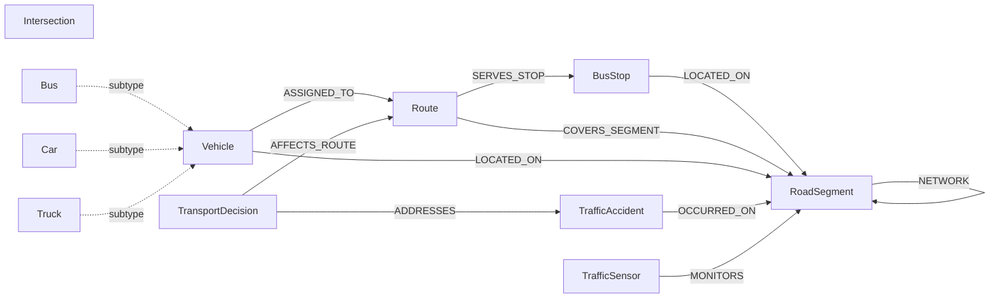

# Urban Digital Transport System — Neo4j Laboratory Work #9

## 1. Laboratory objective

This project implements a **Labeled Property Graph (LPG)** in Neo4j for an Urban Digital Transport System / Intelligent Transportation System (ITS). The original semantic model is treated as the conceptual source model: ontology classes become Neo4j labels, object properties become relationship types, and datatype properties become node or relationship properties.

The implementation is deliberately larger than the minimum laboratory scale:

- **210 nodes**
- **560 relationships**
- deterministic data generation (`seed = 42`)
- 8 principal node labels plus `Bus`, `Car`, and `Truck` subtype labels
- 10 relationship types
- 8 uniqueness constraints
- 6+ secondary indexes
- 15 analytical knowledge queries
- Degree Centrality, PageRank and Betweenness Centrality through Neo4j GDS

> The CSV files in `import/` are generated artifacts. `scripts/generate_graph_data.py` is the authoritative source for recreating them.

---

## 2. LPG schema

### 2.1 Ontology → LPG mapping

| Semantic ontology concept | Neo4j label | Identifier property | Important datatype properties |
|---|---|---|---|
| Intersection | `Intersection` | `id` | `name`, `city`, `latitude`, `longitude`, `location`, `controlType` |
| RoadSegment | `RoadSegment` | `id` | `name`, `lengthM`, `lanes`, `speedLimitKmh`, `hourlyFlow`, `congestionIndex`, `roadClass` |
| BusStop | `BusStop` | `id` | `name`, `stopCode`, `city`, `dailyBoardings`, `shelters` |
| Route | `Route` | `id` | `name`, `routeNumber`, `frequencyMin`, `lengthKm`, `status` |
| Vehicle | `Vehicle` | `id` | `name`, `vehicleType`, `licensePlate`, `speedKmh`, `status` |
| Bus / Car / Truck | `Bus` / `Car` / `Truck` | inherited `Vehicle.id` | inherited vehicle properties |
| TrafficAccident | `TrafficAccident` | `id` | `occurredAt`, `severity`, `injuredCount`, `estimatedCostUah` |
| TransportDecision | `TransportDecision` | `id` | `decisionType`, `decidedAt`, `confidence`, `status` |
| DataSource / traffic sensor | `TrafficSensor` | `id` | `name`, `sensorType`, `observedAt`, `reliability` |

### 2.2 Relationship mapping

| Semantic relation | LPG relationship | Direction | Relationship properties |
|---|---|---|---|
| road connectivity | `NETWORK` | `RoadSegment → RoadSegment` | `travelTimeMin` |
| stop located on segment | `LOCATED_ON` | `BusStop → RoadSegment` | `offsetM` |
| route serves stop | `SERVES_STOP` | `Route → BusStop` | `sequence` |
| route covers segment | `COVERS_SEGMENT` | `Route → RoadSegment` | `sequence` |
| vehicle location | `LOCATED_ON` | `Vehicle → RoadSegment` | `speedKmh` |
| vehicle assigned route | `ASSIGNED_TO` | `Vehicle → Route` | — |
| accident location | `OCCURRED_ON` | `TrafficAccident → RoadSegment` | — |
| decision addresses accident | `ADDRESSES` | `TransportDecision → TrafficAccident` | — |
| decision affects route | `AFFECTS_ROUTE` | `TransportDecision → Route` | — |
| sensor monitoring | `MONITORS` | `TrafficSensor → RoadSegment` | `coverage` |

The schema intentionally keeps the LPG compact: the semantic distinction between `Vehicle` and its subclasses is represented by multiple labels, while operational observations remain properties on graph entities.

### 2.3 Mermaid schema diagram



The source ontology also contains intersection endpoints for road segments. These are retained as `fromIntersectionId` and `toIntersectionId` properties on `RoadSegment`; the explicit road-topology graph used for path algorithms is the `NETWORK` relation between segment nodes.

---

## 3. Project structure

```text
transport-neo4j-system/
├── docker-compose.yml
├── requirements.txt
├── scripts/
│   ├── generate_graph_data.py
│   ├── 01_schema_constraints.cypher
│   ├── 02_load_data.cypher
│   ├── 03_analytical_queries.cypher
│   └── 04_gds_algorithms.cypher
├── import/
│   ├── nodes_intersections.csv
│   ├── nodes_segments.csv
│   ├── nodes_bus_stops.csv
│   ├── nodes_routes.csv
│   ├── nodes_vehicles.csv
│   ├── nodes_accidents.csv
│   ├── nodes_decisions.csv
│   ├── nodes_sensors.csv
│   ├── edges_network.csv
│   ├── edges_has_stop.csv
│   ├── edges_route_stops.csv
│   ├── edges_route_segments.csv
│   ├── edges_located_on.csv
│   ├── edges_assigned_route.csv
│   ├── edges_accidents_segment.csv
│   ├── edges_decisions_accident.csv
│   ├── edges_decisions_route.csv
│   └── edges_sensor_monitors.csv
└── README.md
```

---

## 4. Deterministic data generation

The generator uses Python's `random.seed(42)` and deterministic formulas for identifiers, topology, metrics, and relationships. Re-running it recreates the same logical dataset.

### Windows PowerShell

```powershell
cd transport-neo4j-system
py -m venv .venv
.\.venv\Scripts\Activate.ps1
pip install -r requirements.txt
python scripts/generate_graph_data.py
```

### Linux / macOS / Git Bash

```bash
cd transport-neo4j-system
python3 -m venv .venv
source .venv/bin/activate
pip install -r requirements.txt
python scripts/generate_graph_data.py
```

The generator validates CSV row counts and prints a final node/relationship summary.

---

## 5. Docker deployment

The Compose file uses the Neo4j `2026.09.0` image and mounts the generated CSV directory into `/import` as read-only. The official Docker mechanism installs the Graph Data Science plugin for the lab environment. Neo4j documents Docker Compose deployment and plugin loading in its Operations Manual. citeturn0search6turn0search2

### Start

```bash
docker compose up -d
```

### Check container

```bash
docker compose ps
docker compose logs neo4j
```

### Open Neo4j Browser

```text
http://localhost:7474
```

Credentials:

```text
username: neo4j
password: transportlab2026
```

### Apply schema

```bash
docker exec -i transport-neo4j cypher-shell   -u neo4j -p transportlab2026   < scripts/01_schema_constraints.cypher
```

### Load data

```bash
docker exec -i transport-neo4j cypher-shell   -u neo4j -p transportlab2026   < scripts/02_load_data.cypher
```

### Verify scale

```bash
docker exec -it transport-neo4j cypher-shell   -u neo4j -p transportlab2026   "MATCH (n) RETURN count(n) AS nodes;"

docker exec -it transport-neo4j cypher-shell   -u neo4j -p transportlab2026   "MATCH ()-[r]->() RETURN count(r) AS relationships;"
```

Expected:

```text
nodes          = 210
relationships  = 560
```

### Stop / remove

```bash
docker compose down
```

To remove the persistent database as well:

```bash
docker compose down -v
```

---

## 6. Production-grade DDL rationale

### Uniqueness constraints

Eight identifier constraints are defined:

1. `Intersection.id`
2. `RoadSegment.id`
3. `BusStop.id`
4. `Route.id`
5. `Vehicle.id`
6. `TrafficAccident.id`
7. `TransportDecision.id`
8. `TrafficSensor.id`

These provide entity identity and protect the `MERGE` loading strategy from duplicate domain identifiers.

### Secondary indexes

The schema additionally defines:

- `RoadSegment.hourlyFlow` — range filtering for traffic-volume analysis.
- `RoadSegment.congestionIndex` — range filtering for congestion detection.
- `Vehicle.speedKmh` — speed distribution and operational filtering.
- `TrafficAccident.estimatedCostUah` — financial-impact range queries.
- `(Route.status, Route.frequencyMin)` — composite operational route lookup.
- `RoadSegment.name` — text search.
- `BusStop.name` — text search.

The uniqueness constraints are not counted as the only performance indexes: the project deliberately includes separate range, composite, and text indexes.

---

## 7. Idempotent loading strategy

`02_load_data.cypher` uses `MERGE` on domain identifiers for nodes and `MERGE` on endpoint/type patterns for relationships. Therefore, re-running the load script does not create duplicate entities or duplicate relationships.

CSV values are explicitly converted:

- `toInteger()` for counts, lengths, frequencies and speeds.
- `toFloat()` for congestion, reliability, coverage and confidence.
- `datetime()` for temporal observations and decisions.
- `point()` for intersection geographic coordinates.

No APOC or RDF import plugin is required for data ingestion.

---

## 8. Knowledge Query suite

`03_analytical_queries.cypher` contains 15 queries:

| Query | Knowledge task |
|---|---|
| KQ-01 | Node-property congestion filtering |
| KQ-02 | Relationship-property travel-time filtering |
| KQ-03 | Grouping and statistical aggregation by road class |
| KQ-04 | Route/stop aggregation |
| KQ-05 | Vehicle grouping and descriptive statistics |
| KQ-06 | Accident aggregation by segment |
| KQ-07 | Sensor reliability/coverage aggregation |
| KQ-08 | Variable-length reachable network |
| KQ-09 | Detour discovery |
| KQ-10 | `shortestPath` |
| KQ-11 | `allShortestPaths` |
| KQ-12 | `PROFILE` with indexed identifier lookup |
| KQ-13 | `PROFILE` with range predicate |
| KQ-14 | Cross-domain decision/accident/route aggregation |
| KQ-15 | Routes traversing congested segments |

### Running all analytical queries

Because the file intentionally contains multiple independent statements:

```bash
docker exec -i transport-neo4j cypher-shell   -u neo4j -p transportlab2026   < scripts/03_analytical_queries.cypher
```

For an academic report, execute KQ-01 through KQ-15 individually in Neo4j Browser and capture the result tables and execution plans.

---

## 9. Profiling and performance benchmarking

Use:

```cypher
EXPLAIN
MATCH (s:RoadSegment {id:'SEG-025'})
RETURN s.id, s.name, s.hourlyFlow, s.congestionIndex;
```

Then:

```cypher
PROFILE
MATCH (s:RoadSegment {id:'SEG-025'})
RETURN s.id, s.name, s.hourlyFlow, s.congestionIndex;
```

For the range index:

```cypher
PROFILE
MATCH (s:RoadSegment)
WHERE s.hourlyFlow >= 1600
RETURN s.id, s.name, s.hourlyFlow
ORDER BY s.hourlyFlow DESC;
```

### What to document from the plan

For each profiled query record:

- root operator;
- index operator, e.g. `NodeIndexSeek` / `NodeIndexSeekByRange`, when selected by the planner;
- fallback `NodeByLabelScan`, if applicable;
- `DB Hits`;
- rows;
- memory allocation, where reported;
- total execution time;
- whether sorting or filtering occurs after the index operation.

**Important:** exact DB-hit counts and memory values are runtime-dependent. They should be copied from the actual Neo4j Browser `PROFILE` result rather than fabricated in the report.

A uniqueness lookup on `RoadSegment.id` is expected to be highly selective because the property is protected by a uniqueness constraint. A range query on `hourlyFlow` can use the dedicated range index when the planner determines that the index is beneficial.

---

## 10. GDS / graph algorithms

The official Neo4j Graph Data Science library provides production-quality centrality algorithms including Degree Centrality, PageRank and Betweenness Centrality. citeturn0search0turn0search10

`04_gds_algorithms.cypher` creates a named in-memory projection:

```text
transportRoadNetwork
```

containing:

- `RoadSegment` nodes;
- `NETWORK` relationships;
- undirected orientation;
- `travelTimeMin` as an available relationship property.

### Degree Centrality

Degree Centrality measures the number of adjacent relationships under the selected orientation. In this transport model, high-degree segments are structurally well connected and can act as important transfer points. citeturn0search3

### PageRank

PageRank measures node importance using the structure and importance of incoming relationships. Here it identifies road segments that are structurally important within the road network. citeturn0search8

### Betweenness Centrality

Betweenness Centrality measures how frequently a node occurs on shortest paths between other nodes. In the transport interpretation, high values identify bridge-like road segments that deserve attention in disruption and detour analysis. The GDS implementation exposes both stream and statistics modes. citeturn0search1

Run:

```bash
docker exec -i transport-neo4j cypher-shell   -u neo4j -p transportlab2026   < scripts/04_gds_algorithms.cypher
```

The algorithm output should be captured from the actual environment for the final report because execution times and centrality values are generated from the loaded graph.

---

## 11. Suggested report screenshots

Capture these Neo4j Browser views:

1. `MATCH (n) RETURN labels(n), count(n) ORDER BY count(n) DESC;`
2. `MATCH ()-[r]->() RETURN type(r), count(r) ORDER BY count(r) DESC;`
3. the LPG visualization of the transport network;
4. KQ-03 aggregation table;
5. KQ-06 accident aggregation;
6. KQ-08 reachable network;
7. KQ-10 `shortestPath`;
8. KQ-11 `allShortestPaths`;
9. KQ-12 `PROFILE` plan;
10. KQ-13 `PROFILE` plan;
11. Degree Centrality result;
12. PageRank result;
13. Betweenness Centrality result.

Do not invent screenshots or runtime statistics: use the actual Browser output.

---

## 12. Verification queries

### Node counts by label

```cypher
MATCH (n)
UNWIND labels(n) AS label
RETURN label, count(*) AS count
ORDER BY count DESC;
```

### Relationship counts by type

```cypher
MATCH ()-[r]->()
RETURN type(r), count(*) AS count
ORDER BY count DESC;
```

### Constraint/index inspection

```cypher
SHOW CONSTRAINTS;
SHOW INDEXES;
```

### Geographic point check

```cypher
MATCH (i:Intersection)
RETURN i.id, i.location
ORDER BY i.id
LIMIT 10;
```

### Temporal property check

```cypher
MATCH (a:TrafficAccident)
RETURN a.id, a.occurredAt, a.severity
ORDER BY a.occurredAt
LIMIT 10;
```

---

## 13. Technical design decisions

### Why LPG instead of retaining RDF triples?

The laboratory objective is a Neo4j graph database, so the ontology is used as the conceptual schema rather than being stored as RDF triples. LPG labels provide efficient entity categorization, typed relationships encode domain semantics directly, and scalar/temporal/spatial properties remain attached to the relevant graph entities.

### Why use segment-to-segment `NETWORK` relationships?

Path algorithms operate directly on the transport topology. A segment-level network avoids forcing path queries to alternate through every intersection, making reachability and detour queries concise and directly aligned with road-segment operational analysis.

### Why keep intersection IDs on segments?

The original ontology contains `Intersection` entities and road endpoints. Keeping `fromIntersectionId` and `toIntersectionId` preserves that semantic information without introducing additional relationship types that are not needed by the laboratory's requested analytical workload.

### Why use deterministic data?

A deterministic dataset makes the laboratory reproducible: the same source script produces the same identifiers, metrics and topology, which makes screenshots, query outputs and grading easier to verify.

---

## 14. Expected laboratory conclusion

The laboratory work resulted in a functional Neo4j Labeled Property Graph representing an Urban Digital Transport System. The semantic ontology was transformed into an LPG schema in which domain classes were represented by labels, object relations by typed relationships, and datatype assertions by strongly typed properties.

The generated dataset contains **210 nodes and 560 relationships**, exceeding the required minimum scale. The database schema includes eight uniqueness constraints and multiple range, composite and text indexes. Data ingestion is implemented with idempotent `LOAD CSV` and `MERGE` operations, while numeric, temporal and spatial values are explicitly converted to appropriate Neo4j property types.

The analytical layer demonstrates property filtering, relationship filtering, aggregation, statistical summaries, variable-length traversal, detour discovery, `shortestPath`, and `allShortestPaths`. Query profiling makes it possible to compare index-backed access with broader scans using the actual Neo4j execution plan.

Finally, Neo4j Graph Data Science extends the database with Degree Centrality, PageRank and Betweenness Centrality. These algorithms provide graph-topological measures that can support interpretation of important and structurally critical road segments in an intelligent transport system. The resulting architecture therefore combines semantic modeling, persistent graph storage, analytical Cypher, performance analysis and graph algorithms in a single reproducible laboratory project.

---

## 15. Cleanup

```bash
docker compose down -v
```

This removes the Neo4j data volumes. The source CSVs and Cypher/Python project files remain in the project directory.
